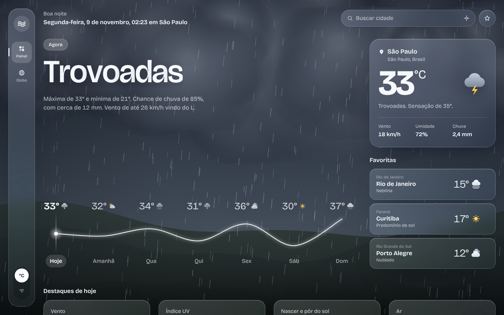
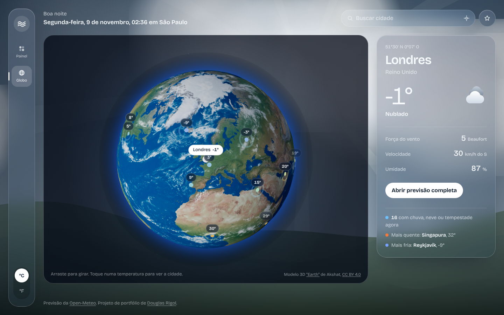

# Nimbo · Previsão do tempo imersiva

App de clima em **React + TypeScript** com um cenário animado que reproduz o tempo real da cidade, painel em vidro fosco e um globo 3D com o tempo agora pelo mundo.



## Destaques

- **Cenário vivo em 2D + 3D.** O céu reflete o tempo real: chuva inclinada pela direção e força do vento, raios com clarão na tempestade, neve, neblina, estrelas e colinas com parallax que segue o mouse. Os astros e as nuvens vêm de modelos 3D:
  - **Sol** em GLB com animação de superfície (morph) e shader próprio: centro claro, borda alaranjada e granulação que "ferve";
  - **Lua** com textura real, iluminada de lado para mostrar o relevo;
  - **Nuvens volumétricas**: o modelo é renderizado uma vez ao carregar, em 4 ângulos e 3 tons (dia, tempestade, noite), e vira imagem. O visual é o do modelo 3D, com custo de imagem.

- **Curva da semana interativa.** Clique num dia, ou use as setas do teclado, e o título, o resumo e o cenário mudam para a previsão daquele dia.
- **Globo 3D** (Three.js / React Three Fiber) com um modelo realista da Terra (`public/models/earth.glb`). Mostra o tempo agora em 28 cidades, com cor por temperatura e anéis pulsando onde chove. Clique numa cidade e a câmera gira até ela.
- **Animações com GSAP.** Entrada orquestrada dos painéis, título letra por letra (SplitText), curva se desenhando (DrawSVG) e temperatura contando até o valor atual.
- **Fonte que reage à temperatura.** O número principal usa a Bricolage Grotesque variável: quanto mais quente, mais grosso e largo.
- **Destaques do dia.** Vento com bússola, escala Beaufort e barras das próximas 24h; medidor de índice UV; arco do sol com a posição atual; umidade, nuvens, visibilidade e pressão; gráfico de temperatura e chance de chuva hora a hora.



## Desempenho

O cenário foi montado em camadas para rodar leve:

1. **Fundo (canvas 2D, resolução 1x):** céu, estrelas e o brilho do sol e da lua.
2. **Astro (WebGL):** um canvas pequeno, só do tamanho do sol ou da lua, redesenhado a 15 fps e movido por `transform` em CSS.
3. **Frente (canvas 2D):** nuvens (imagens pré-renderizadas), colinas em cache que só deslizam, chuva e neve desenhadas em lote.
4. **Sombra (CSS):** vinheta e degradê atrás do título, sem custo por quadro.

O Three.js e os modelos só carregam depois da primeira pintura, e o cenário pausa na aba do globo e com a aba do navegador oculta. Num navegador sem placa de vídeo (renderização por software), o painel passou de 0,3 para cerca de 38 quadros por segundo depois dessa reorganização.

## Funcionalidades

- Busca de cidades com sugestões (debounce, `AbortController`, navegação por teclado e ARIA de combobox)
- Localização pelo navegador
- Cidades favoritas salvas no `localStorage`, com o tempo de todas numa única requisição
- °C / °F sem buscar os dados de novo
- Relógio na hora local da cidade
- Globo carregado sob demanda (`React.lazy`): o Three.js só é baixado quando a aba abre
- Responsivo: no celular, a barra lateral vira barra inferior
- `prefers-reduced-motion` respeitado em todo o app (cenário estático, sem animações GSAP)
- 14 testes unitários com Vitest

## Stack

| Parte | Tecnologia |
| --- | --- |
| Interface | React 19, TypeScript `strict`, Vite |
| Animação | GSAP (SplitText, DrawSVG) com `@gsap/react` |
| 3D | Three.js, React Three Fiber, Drei |
| Cenário | Dois canvas 2D com motor próprio + canvas WebGL pequeno para o sol e a lua (GLB) |
| Modelo da Terra | GLB carregado com `useGLTF` (textura 4K em WebP, 1,75 MB) |
| Estilo | CSS puro (backdrop-filter, variáveis) |
| Dados | [Open-Meteo](https://open-meteo.com/) (sem chave de API) |
| Testes | Vitest |

## Como rodar

```bash
npm install
npm run dev      # http://localhost:5173
npm test
npm run build
```

## Publicar na Vercel

Suba o projeto para o GitHub, importe o repositório na Vercel e clique em **Deploy**. Ela detecta o Vite sozinha. Não precisa de variável de ambiente.

## Estrutura

```
src/
├── api/openMeteo.ts          # previsão, várias cidades de uma vez, busca, localização
├── scene/
│   ├── WeatherEngine.ts      # motor do cenário (chuva, raios, neve, nuvens, colinas)
│   ├── Sky3D.ts              # sol e lua 3D ao vivo; nuvens 3D pré-renderizadas em imagens
│   ├── sceneParams.ts        # traduz o tempo real em parâmetros do cenário
│   └── WeatherScene.tsx
├── globe/
│   ├── GlobeCanvas.tsx       # globo 3D, marcadores, câmera, rótulos
│   ├── GlobeView.tsx         # tela do globo com painel lateral
│   └── geo.ts                # latitude/longitude → posição 3D
├── components/               # Sidebar, TopBar, Hero, WeekCurve, NowCard, CityList, Highlights...
├── hooks/                    # useForecast, useCitiesNow, useLocalStorage, useReducedMotion...
├── lib/                      # formatação, códigos WMO, resumo do dia, curvas, GSAP, testes
├── App.tsx
└── index.css
```

## Créditos

Modelos 3D do Sketchfab, todos com licença [CC BY 4.0](https://creativecommons.org/licenses/by/4.0/):

- [“Earth”](https://sketchfab.com/3d-models/earth-41fc80d85dfd480281f21b74b2de2faa) e [“Moon”](https://sketchfab.com/3d-models/moon-4db2273f6dd943b8ad7fa5e3b1b2431a) de Akshat
- [“The Sun”](https://sketchfab.com/3d-models/the-sun-8f31ed4194e34f91bdacbd85dfc5fb39) de tamminen
- [“Fluffy Cloud”](https://sketchfab.com/3d-models/fluffy-cloud-2c887a28840f47cfae6b5dee0d11b842) de Loïc Norgeot

Alterações: materiais convertidos para o padrão atual do glTF, texturas redimensionadas e comprimidas, geometria do sol quantizada (com o [glTF Transform](https://gltf-transform.dev/)); o sol recebeu um shader próprio no app.
- Dados de previsão: [Open-Meteo](https://open-meteo.com/).

---

Feito por [Douglas Rigol](https://www.linkedin.com/in/douglas-rigol).
